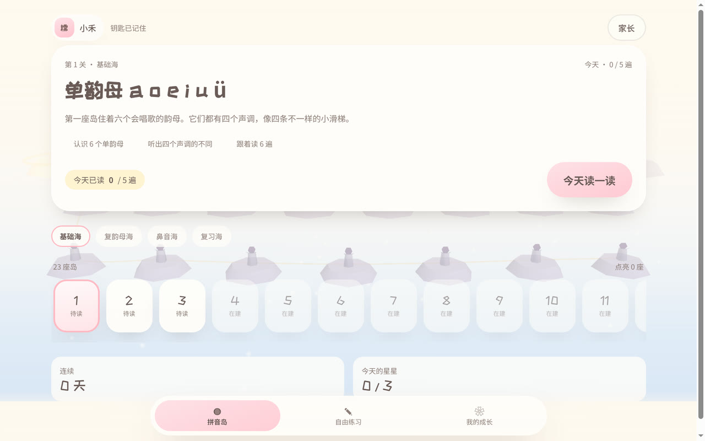
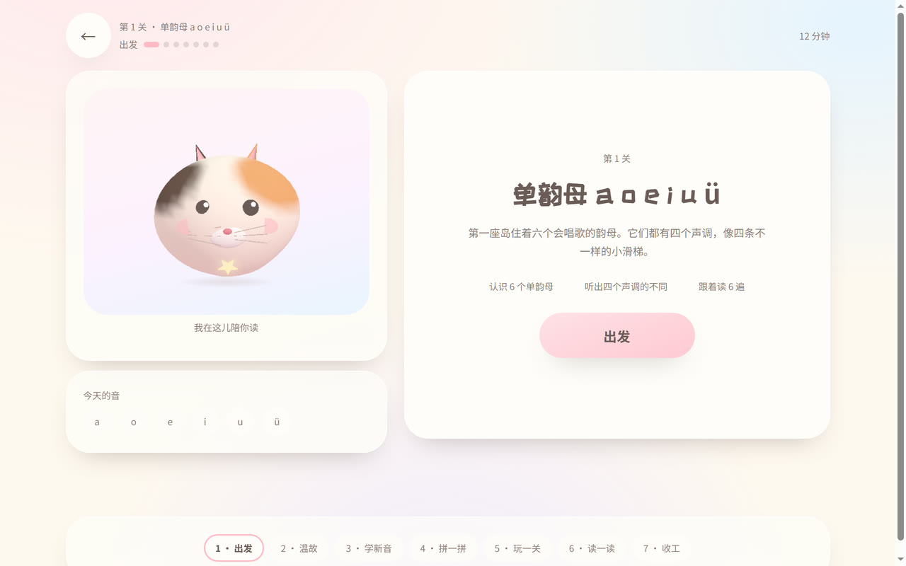
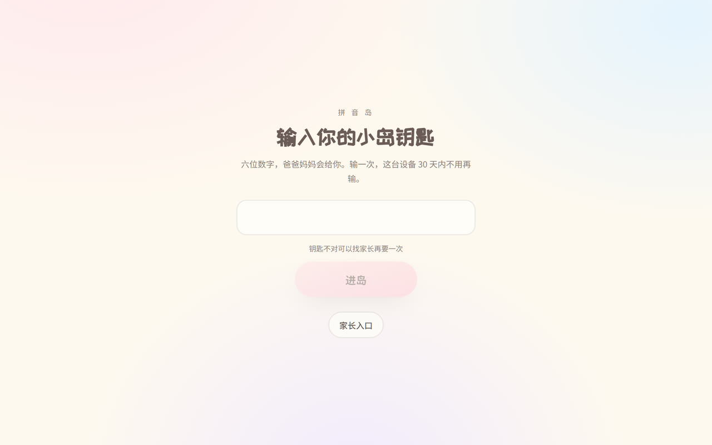
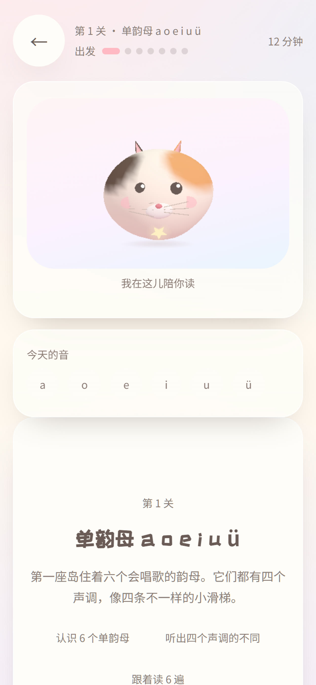

<div align="center">

# 拼音岛 · 声音收集计划

**给 6 岁孩子的拼音学习网站** —— 3D 小猫陪读、真人发音、23 天闯关、家长端可看进度

[](https://pinyin.shankluo.cc)
[](https://react.dev)
[](https://www.typescriptlang.org/)
[](https://threejs.org)
[](https://vite.dev)
[](#-许可)
[](#-音频与署名)



<sub>地图页：23 座浮岛对应 23 天课程，完成后点亮</sub>

</div>

---

## 这是什么

一个给刚上一年级的孩子用的拼音闯关网站。不是练习册的电子版，重点在**让孩子开口读**：

- 每天 7 步：出发 → 温故 → 学新音 → 拼一拼 → 玩一关 → 读一读 → 收工
- 全程有一只三花小猫（程序化 3D，无模型文件）陪着，读 a/o/e 时它的嘴会跟着张
- 129 条发音全部是真人录音，不是 TTS
- 读完可以录下来自己回放对比——**不打分，也不评价对错**
- 家长端看今日卡、一句话建议、23 天对照表（可截图发给老师）

面向单个家庭设计，现在支持多孩：每个孩子一把六位数字钥匙。

## 截图

<div align="center">
<table>
<tr>
<td width="50%"><br /><sub><b>每日闯关</b>：今天要学什么、要读几遍，一屏说清</sub></td>
<td width="50%"><br /><sub><b>钥匙登录</b>：输一次记 30 天，过期后同一把钥匙可再进</sub></td>
</tr>
<tr>
<td colspan="2"><br /><sub><b>手机端</b>：单手可点，按钮都在拇指区</sub></td>
</tr>
</table>
</div>

## 特性

| | |
|---|---|
| **真人发音** | 129 条 audio-cmn 录音，统一 22.05kHz / -16 LUFS，用 sha256 做缓存指纹 |
| **程序化 3D** | 三花猫与浮岛全部代码生成，无 glTF、无贴图文件；单 renderer、锁 30fps |
| **口型联动** | 读 a/o/e/i/u/ü 时切换六套口型几何，是教学功能不是装饰 |
| **随机出题** | 温故与四声题每次洗牌，并避免连续三次同一声调 |
| **不制造挫败** | 没有红叉、失败音效、倒计时、排行榜、连续打卡压力 |
| **家长端** | 今日卡、朗读遍数、一句话建议、23 天对照表、重置进度 |
| **多孩支持** | 六位数字钥匙 + 30 天会话，进度按钥匙绑定 |
| **离线可用** | 构建产物 1.8MB，音频 1.6MB，可直接整包缓存 |

## 快速开始

```bash
npm install
cp public/access.example.json public/access.json   # 配一把自己的钥匙
npm run dev                                        # http://127.0.0.1:3000
npm run build
```

家长入口初始密码 `1234`（在家长端可改）。

> 需要 Node 20+。`npm run build` 在本机沙箱环境可能被「安全删除」策略拦下，
> 处理方式见 [DEPLOY.md](./DEPLOY.md)。

## 钥匙机制

**钥匙不在仓库里，也不打进 JS 包。**

- 清单放在 `public/access.json`（已 gitignore），运行期 `fetch('/access.json')` 读取
- 部署时由 `scripts/deploy.sh` 单独上传到服务器根目录
- 仓库里只有 `public/access.example.json` 作为格式示例

```json
{
  "codes": [
    { "code": "123456", "id": "kid_he", "name": "小禾", "avatar": "nuo" }
  ]
}
```

- `code` 六位数字，发给家长
- `id` 进度主键，**改了就等于换人**，不要动
- 输入一次记 30 天；过期后同一把钥匙仍可登录，进度不丢
- 同一台设备换人：点左上角头像退出

> 六位数字是分发口令，不是安全认证——拿到号码的人都能进。
> 真实的多租户隔离需要后端，见「路线图」。

## 项目结构

```
src/
├── content/     23 天课程、63 个音素、音频请求清单
├── data/        进度/复习/徽章（localStorage）、钥匙会话、徽章定义
├── audio/       Web Audio 播放，缺文件回退 TTS
├── three/       三花猫与浮岛（命令式，单 renderer）
├── components/  角色容器、浮岛背景、导航、Toast
├── pages/       Gate / Map / DayFlow / Practice / Growth / Parent
└── styles.css   设计令牌 + 全部样式（不引 UI 框架）
tools/           音频生成、替换、校验脚本
scripts/         一键发布
docs/images/     README 截图
```

## 教学设计

三条红线，写在代码之前：

1. **朗读优先**：每个环节都指向开口，不做纯刷题
2. **不制造挫败**：错了弹出小猫说话气泡 + 柔和的下降提示音；温故连错三次直接亮答案并跳过，且不计入正确率
3. **3D 不承载信息**：所有拼音文字用 DOM 渲染，WebGL 不可用时静默降级为平面角色

前 3 关每一步都由一只会摆动的小猫（SVG 程序化生成）在任务卡右上角用说话气泡提示该做什么；进入时弹一次，孩子 12 秒没操作会再弹一次。答错时换成橙色气泡、猫头左右摇头并播柔和提示音。第 4 关起不再出现。

四声用「滑梯」隐喻（一声平、二声上坡、三声先下后上、四声下坡），配合真人录音与口型，
让孩子先建立听感，再认调号。

## 音频与署名

| 项目 | 说明 |
|---|---|
| 来源 | [audio-cmn](https://github.com/hugolpz/audio-cmn)（Chen Wang） |
| 许可 | **CC BY-SA 4.0** |
| 数量 | 129 条，其中 128 条真人、1 条合成（`fin_ong`） |
| 规格 | 22.05kHz 单声道 48kbps，响度 -16 LUFS，首尾留白 80/110ms |
| 例外 | 普通话 `ong` 不能独立成音节，上游无单音录音，故保留合成并标注 |

完整署名、处理链与已知局限见 [`public/audio/v1/ATTRIBUTION.md`](public/audio/v1/ATTRIBUTION.md)。
**转载或再发布时请保留该署名**——CC BY-SA 要求署名并以相同方式共享。

角色「糯糯」与浮岛是程序化几何原创，不含第三方模型或贴图。

## 部署

线上跑在腾讯云轻量服务器 + Cloudflare Tunnel（不开放公网端口）。

```bash
./scripts/deploy.sh           # 只发前端
./scripts/deploy.sh --audio   # 连音频一起发
```

服务器结构、密钥交接、回滚与常见坑见 **[DEPLOY.md](./DEPLOY.md)**。

## 路线图

- [x] 前 3 天内容闭环（129 条音频、7 步流程、三个小游戏）
- [x] 多孩钥匙登录（30 天会话）
- [x] 三花猫角色与口型联动
- [ ] 第 4–23 天内容与音频
- [ ] 完整 SM-2 间隔重复队列
- [ ] 后端同步（跨设备进度、真正的钥匙校验）
- [ ] 录音本地留存（需先解决隐私与合规）

## 已知限制

- 进度只在本机 `localStorage`，换设备不同步
- 录音仅内存回放，不落盘（合规红线）
- 两条多音字音频（得 / 发）尚未人耳复核，manifest 标 `pending-human`
- 无自动化测试，验证靠类型检查 + 手动走查

## 许可

- **代码**：[MIT](./LICENSE)
- **音频**：CC BY-SA 4.0，见 [ATTRIBUTION.md](public/audio/v1/ATTRIBUTION.md)

<div align="center"><sub>做给一个六岁小孩，也为所有刚学拼音的小孩。</sub></div>
